# UX/UI-аудит fitnoss

1 ноября 2026

Основные сценарии работают: удалось добавить шаблон, начать тренировку, отметить подход и сохранить неполный результат. Главная зона улучшения — ясность действий и данных во время тренировки. Вторая — помощь новичку в выборе программы и восстановлении поиска. Полная смена визуального стиля не требуется.

## Объём и ограничения

Живой обход http://localhost:5173: первый вход, шаблоны, редактор, активная тренировка, подход и отдых, каталог, фильтры, поиск без результатов, техника, пустой прогресс, сохранение неполной тренировки, настройки и калькулятор 1ПМ. Основной просмотр — 554×621; дополнительно 390×844 и 1440×900. Проверены тёмная и светлая темы.

Это экспертный аудит, а не исследование с пользователями. Влияние на конверсию и ошибки — гипотезы. Не проверялись физический телефон, экранная клавиатура, офлайн, установка PWA, импорт/экспорт, все калькуляторы и все записи каталога. Снимки фиксируют конкретные состояния; видимость dev-ссылки относится только к локальному запуску. Полный аудит доступности и проверка соответствия WCAG не проводились.

Для проверки в отдельной сессии встроенного браузера создан шаблон «Дома без инвентаря» и сохранена тестовая тренировка с одним подходом. Эти записи находятся в хранилище тестового браузера. Исходники интерфейса не изменялись.

## Что уже хорошо

- Компактная постоянная навигация и единый визуальный язык.

- Автосохранение явно объяснено в редакторе.

- Фильтры показывают количество результатов и выбранные условия.

- Подход отмечается одним действием, отдых запускается автоматически.

- Завершение неполной тренировки объясняет сохранение и возможность продолжить план.

- В настройках ясно сказано о локальном хранении данных и составе резервной копии. Структуру «Ещё → настройки» стоит сохранить, как и калькуляторы/«О приложении» сверху.

## Приоритеты

P1 — исправить в первую очередь: риск ошибки в данных или затруднение основного сценария. P2 — заметное трение. P3 — улучшение эффективности. Это экспертная оценка, не классификация аварий. S — локальное изменение; M — несколько компонентов или изменение поведения. Оценки относительные, без обещаний сроков.

## 01. P1 · Сброс поиска уничтожает полезный запрос

**Где / воспроизведение:** Упражнения → Фильтры → Грудь → поиск «присед» → Сбросить в пустом состоянии.

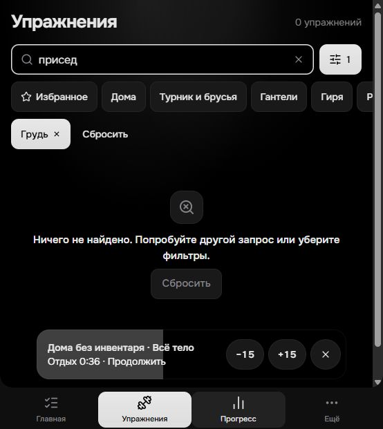

**Наблюдение:** Результатов нет. Нажатие «Сбросить» удаляет одновременно запрос и выбранную мышцу и возвращает все 968 упражнений. Это подтверждено действием в интерфейсе и обработчиком setFilters(EMPTY_FILTERS).

**Почему мешает:** Пользователю приходится повторять ввод, хотя для восстановления выдачи достаточно убрать конфликтующий фильтр.

**Решение:** Основное действие: «Искать “присед” без фильтров» с сохранением q. Отдельно оставить «Очистить поиск» и второстепенное «Сбросить всё». По возможности показать количество результатов без фильтров.

**Критерий приёмки:** После снятия фильтров запрос «присед» остаётся в поле и URL; выдача обновляется. Полная очистка выполняется отдельным явно названным действием.

**Объём:** S. **Точки изменения:** src/features/catalog/CatalogPage.tsx.

## 02. P1 · Вес для упражнений со своим весом не объяснён

**Где / воспроизведение:** Шаблон «Дома без инвентаря» → Начать тренировку → отжимания / приседания / планка.

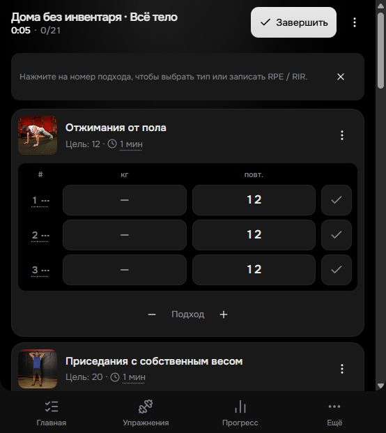

**Наблюдение:** Во всех строках есть столбец «кг» с пустым значением «—». Не объяснено, записывать ли массу тела, дополнительное отягощение или оставлять поле пустым.

**Почему мешает:** В основном сценарии дневника пользователь может записать разные по смыслу величины; статистику таких записей будет трудно интерпретировать.

**Решение:** Для упражнений со своим весом по умолчанию показывать только повторы или секунды. Добавить действие «Дополнительный вес» с явной подписью. Для упражнений с помощью/противовесом отдельно определить смысл величины.

**Критерий приёмки:** В отжиманиях и планке без отягощения нет необъяснённого поля «кг»; при включении веса видно, что это дополнительный вес. Соответствующий смысл сохранён в истории.

**Объём:** M. **Точки изменения:** src/features/workout/ExerciseCard.tsx.

## 03. P1 · Плавающий отдых перекрывает изучаемую технику

**Где / воспроизведение:** Отметить подход → открыть каталог → Отжимания от пола → прокрутить к технике во время отдыха.

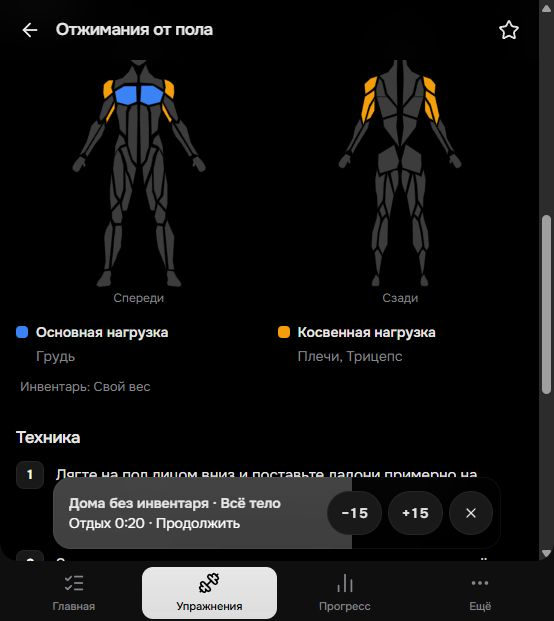

**Наблюдение:** Широкая панель продолжения тренировки располагается поверх текста техники и карты мышц. Прокрутка позволяет открыть текст, но в текущем положении часть материала скрыта.

**Почему мешает:** Именно во время отдыха пользователь может изучать следующее упражнение; панель отнимает полезное место и заставляет дополнительно прокручивать страницу.

**Решение:** Вне тренировки закрепить компактную строку статуса в выделенной области над навигацией, уменьшив высоту области прокрутки на её реальную высоту. Расширенные −15/+15 показывать по нажатию на время. Сохранить быстрый возврат к тренировке.

**Критерий приёмки:** При открытии техники и перемещении фокуса текст/ссылка полностью видны над панелью. Проверить 390×844, короткий экран и увеличенный шрифт. Нижний padding уже есть в Layout; одного увеличения отступа в конце страницы недостаточно для текущего перекрытия в середине.

**Объём:** M. **Точки изменения:** src/features/workout/RestTimerBar.tsx; src/app/Layout.tsx.

## 04. P2 · Крестик означает пропуск отдыха, но выглядит как закрытие панели

**Где / воспроизведение:** Активная тренировка → выполнить подход → панель отдыха справа.

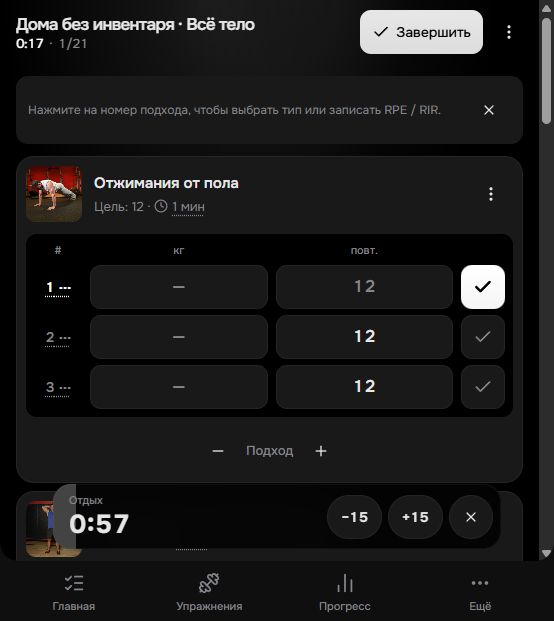

**Наблюдение:** Кнопка с X вызывает stopRest; доступное имя — «Пропустить отдых». Визуально действие не подписано.

**Почему мешает:** Пользователь может ожидать сворачивания панели, а фактически завершить отдых. Это конфликт смысла иконки и результата.

**Решение:** Заменить X на «Пропустить» / иконку перехода с видимой подписью. Если нужно сворачивание, сделать его отдельным действием с сохранением работающего таймера.

**Критерий приёмки:** По внешнему виду понятно, какое действие останавливает отдых; сворачивание, если добавлено, не сбрасывает таймер.

**Объём:** S. **Точки изменения:** src/features/workout/RestTimerBar.tsx.

## 05. P2 · Первый экран скрывает создание программы за «Выбрать»

**Где / воспроизведение:** Главная в пустом состоянии.

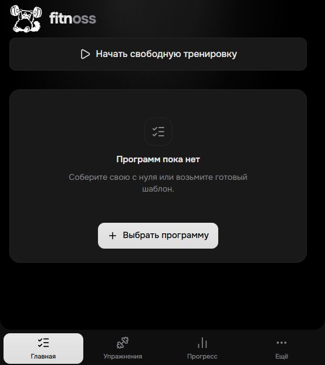

**Наблюдение:** Текст предлагает собрать программу с нуля или взять шаблон, но единственная кнопка называется «Выбрать программу». Создание с нуля становится видно только внутри следующего окна.

**Почему мешает:** Неочевидно, что собственную программу тоже можно создать здесь. Свободная тренировка находится отдельно и не объясняет отличие от программы.

**Решение:** В пустом состоянии дать основной CTA «Подобрать шаблон» и вторичный «Создать с нуля». Под свободной тренировкой кратко объяснить: «Добавляйте упражнения по ходу занятия».

**Критерий приёмки:** На первом экране явно доступны оба пути к программе, а название каждого действия совпадает с открываемым экраном.

**Объём:** S. **Точки изменения:** src/features/programs/ProgramsPage.tsx.

## 06. P2 · Шаблоны трудно сравнить по нагрузке и опыту

**Где / воспроизведение:** Главная → Выбрать программу → Шаблоны.

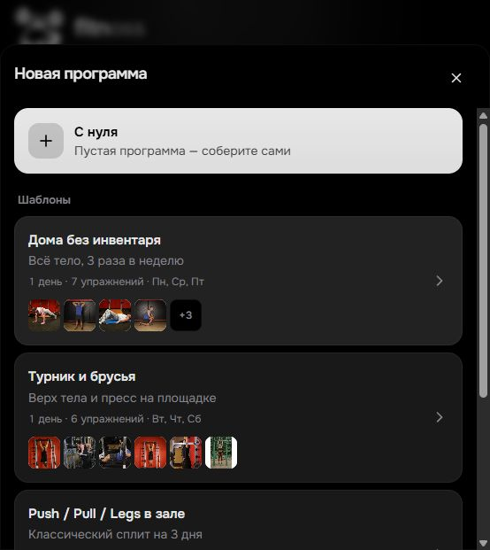

**Наблюдение:** Есть инвентарь, частота и число упражнений, но нет ориентиров по опыту и длительности занятия. «1 день · … · Пн, Ср, Пт» смешивает число уникальных тренировок и число занятий в неделю.

**Почему мешает:** Новичок должен открыть несколько шаблонов и сам оценить применимость. Число «1 день» можно прочитать как одно занятие в неделю.

**Решение:** Писать «1 тип тренировки · 3 занятия/нед». Добавить проверенный уровень и ориентировочную длительность с пояснением, что она включает отдых. Не назначать всем шаблонам уровень автоматически — нужна содержательная оценка.

**Критерий приёмки:** На карточке без открытия понятно: необходимый инвентарь, опыт, частота, длительность и число разных тренировок.

**Объём:** M. **Точки изменения:** src/features/programs.

## 07. P2 · Редактор оставляет большую закреплённую шапку

**Где / воспроизведение:** Программа → Редактировать → раскрыть первое упражнение.

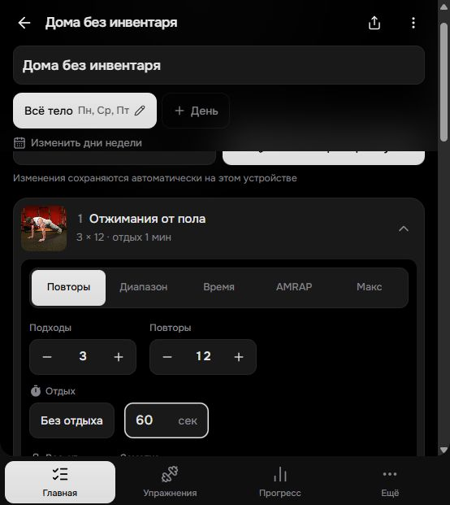

**Наблюдение:** Название, поле названия, выбор дня и расписание остаются закреплены. При небольшой прокрутке кнопки «Готово»/старта частично уходят под шапку. Ниже одновременно представлены пять режимов, включая AMRAP и «Макс».

**Почему мешает:** На коротком экране меньше места для редактирования самого упражнения; назначение редких режимов приходится угадывать.

**Решение:** При прокрутке сворачивать шапку до названия и текущего дня. Поле названия и расписание оставить в верхней незакреплённой области. По умолчанию показывать основной режим; редкие режимы убрать в «Тип цели» с короткими определениями, сохранив доступность для опытных пользователей.

**Критерий приёмки:** На высоте 621 px раскрытое упражнение получает больше места, чем шапка. Основные действия не выглядят обрезанными в устойчивом состоянии; AMRAP имеет понятное объяснение.

**Объём:** M. **Точки изменения:** src/features/programs/ProgramEditorPage.tsx; src/shared/components/PageHeader.tsx.

## 08. P2 · Фильтры требуют знания анатомии и собственной логики

**Где / воспроизведение:** Каталог → Фильтры.

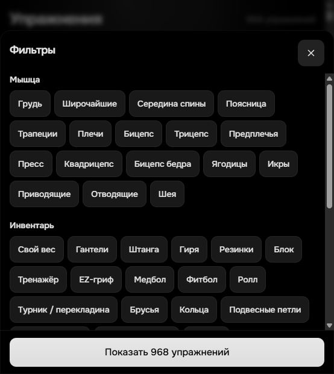

**Наблюдение:** Сразу представлены 17 мышечных групп и длинный набор инвентаря. До уровня и типа нужна прокрутка. Не объяснено, как сочетаются несколько мышц и несколько предметов инвентаря.

**Почему мешает:** Новичку сложно перевести цель «спина» в «широчайшие / середина / поясница / трапеции» и предсказать результат нескольких выбранных условий.

**Решение:** Добавить простой выбор областей тела с раскрытием деталей; инвентарь сгруппировать, сохранив все варианты. Коротко описать фактическую логику сочетания условий. Не обещать «доступно с моим инвентарём», если фильтр означает лишь наличие одного совпадения.

**Критерий приёмки:** Выбор «спина» возможен без знания отдельных мышц. Поведение нескольких выбранных фильтров соответствует видимому пояснению; счётчик результатов сохраняется.

**Объём:** M. **Точки изменения:** src/features/catalog/FilterBar.tsx; src/features/catalog/filters.ts.

## 09. P2 · Пустой прогресс начинает с больших нулей

**Где / воспроизведение:** Прогресс до сохранения первой тренировки.

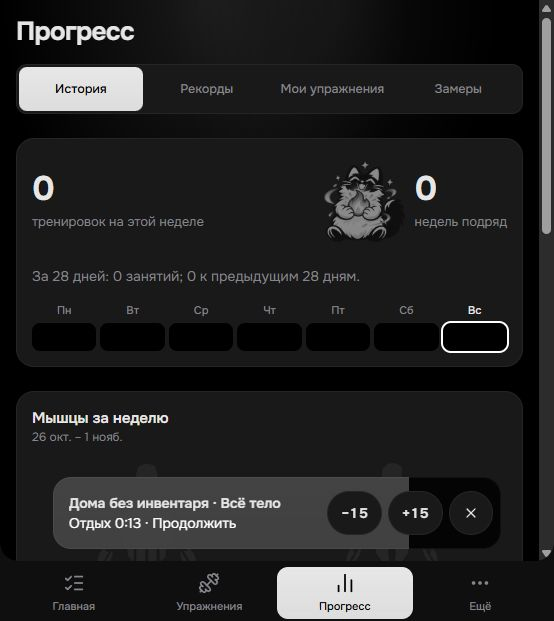

**Наблюдение:** Первый экран занят нулевыми метриками, календарём и началом пустой карты мышц. Объяснение о завершённых тренировках находится дальше по странице; прямого стартового действия нет.

**Почему мешает:** Страница выглядит как отчёт без данных и не помогает получить первый полезный результат.

**Решение:** До первой завершённой тренировки поставить компактное вступление «Завершите первую тренировку — здесь появится прогресс» и CTA «Начать тренировку» / «Продолжить текущую». Нулевую аналитику свернуть или заменить коротким превью будущих данных.

**Критерий приёмки:** При пустой истории первый экран объясняет, откуда появятся данные, и содержит подходящее действие. После сохранения тренировки показывается обычная аналитика.

**Объём:** S. **Точки изменения:** src/features/journal.

## 10. P2 · Ссылки на технику в тренировке не имеют доступного имени

**Где / воспроизведение:** Активная тренировка → ссылка на миниатюре отжиманий, затем приседаний.

**Наблюдение:** В дереве доступности ссылки представлены только URL /#/ex/pushups и /#/ex/bodyweight-squat, без названия действия или упражнения. У полей и кнопок отметки подхода имена, напротив, подробные.

**Почему мешает:** Пользователю скринридера трудно понять, какая ссылка откроет технику нужного упражнения.

**Решение:** Добавить доступное имя вида «Техника: Отжимания от пола». Проверить, что изображение не создаёт дублирующее озвучивание, а фокус виден.

**Критерий приёмки:** В дереве доступности каждая ссылка на технику имеет уникальное имя. Проверить Tab/Enter и чтение имен хотя бы одним скринридером; такой прогон в этом аудите не выполнен.

**Объём:** S. **Точки изменения:** src/features/workout/ExerciseCard.tsx.

## 11. P2 · Блок «Видео» отправляет в общий поиск, а статус перевода не помогает сообщить ошибку

**Где / воспроизведение:** Упражнения → Отжимания от пола → низ страницы.

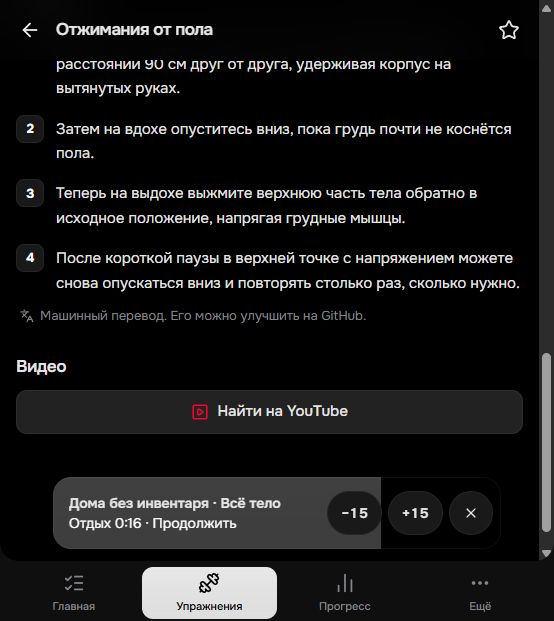

**Наблюдение:** Под заголовком «Видео» только кнопка «Найти на YouTube». Над ней — текст «Машинный перевод. Его можно улучшить на GitHub». Для примера инструкция содержит конкретное расстояние «90 см», но пользователь не видит статуса проверки содержания.

**Почему мешает:** Блок обещает готовое видео, но выводит из сценария. При сомнении в инструкции неясно, как сообщить о конкретной проблеме без работы с репозиторием.

**Решение:** При отсутствии привязанного видео назвать блок «Поиск видео» и явно обозначить внешний переход. Для инструкций ввести статус редакторской проверки и действие «Сообщить о неточности» с названием упражнения. Содержательную корректность техники проверить отдельно со специалистом; этот аудит не устанавливает медицинскую или тренерскую корректность.

**Критерий приёмки:** До клика ясно, что откроется поиск YouTube. Статус перевода и проверки различается. Сообщение об ошибке можно начать из карточки конкретного упражнения.

**Объём:** M. **Точки изменения:** src/features/catalog/ExercisePage.tsx.

## 12. P3 · Десктоп сохраняет узкую колонку мобильного каталога

**Где / воспроизведение:** Каталог при 1440×900; дополнительно проверена светлая тема.

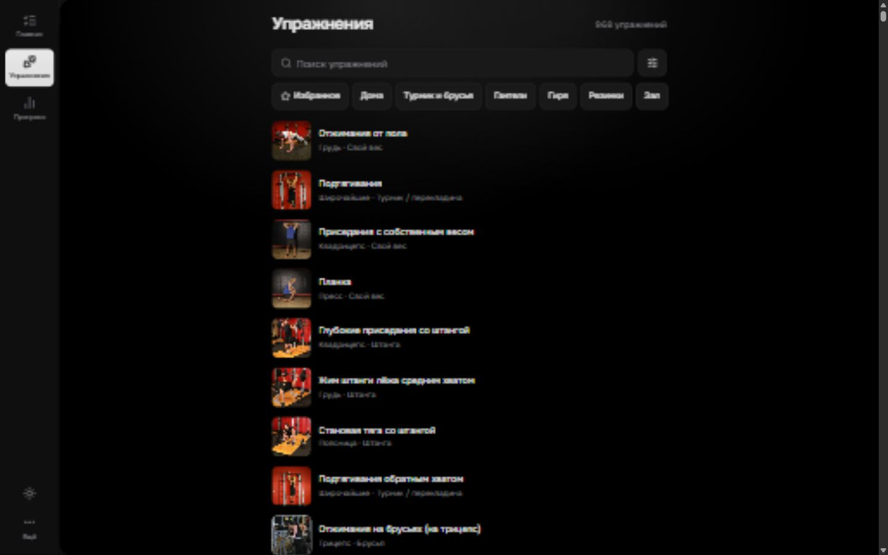

**Наблюдение:** Навигация становится боковой, но основной контент ограничен max-w-2xl. У списка остаются большие свободные поля, при этом плотность видимых упражнений почти не меняется.

**Почему мешает:** На широком экране теряется возможность быстрее сравнивать упражнения. Это возможность улучшения, а не поломка адаптации.

**Решение:** Расширить только каталог на больших экранах и проверить вариант из двух колонок либо постоянные фильтры слева от списка. Страницы техники с текстом оставить узкими. Выбрать вариант после проверки задач поиска и сравнения.

**Критерий приёмки:** На 1440 px полезное пространство используется для поиска/сравнения без растягивания строк инструкции и без ухудшения порядка клавиатурного фокуса.

**Объём:** M. **Точки изменения:** src/app/Layout.tsx; src/features/catalog/ExerciseList.tsx.

## Дополнительные наблюдения

- На мобильном 390×844 быстрые фильтры уходят за правую границу горизонтальной ленты. Это рабочий паттерн, но можно добавить мягкий край/частично видимый следующий чип как подсказку прокрутки; см. 13-catalog-mobile.jpg.

- В локальных настройках видна Video review (dev). Это не подтверждённая проблема production: проверить, что ссылка не попадает в публичную сборку; см. 11-settings.jpg.

- У записи завершённой тренировки отдельно стоит число 12 без подписи единицы. В строках с несколькими типами целей стоит явно писать «12 повт.» / «45 с»; см. 12-session-mobile.jpg.

- Вторичный текст часто небольшой и серый. Не делаю вывода о нарушении контраста по снимкам: нужна отдельная проверка фактических сочетаний цветов, размеров, состояний и пользовательских акцентов в обеих темах.

## Порядок работы

1. Первый пакет: сохранить запрос при снятии фильтров; объяснить вес в тренировке; устранить перекрытие техники панелью отдыха.

2. Быстрые улучшения: подписать пропуск отдыха, развести CTA первого входа, добавить осмысленное пустое состояние прогресса и доступные имена ссылок.

3. Следующий пакет: компактная шапка редактора, объяснения режимов, сравнимые шаблоны и упрощённый вход в фильтры.

4. После этого: редакционная проверка инструкций, корректные ожидания от видео и проверка альтернативного десктопного каталога.

## Как проверить эффект

После исправлений провести короткие наблюдаемые сессии с новичками и людьми, ведущими дневник: создать программу, выбрать шаблон, найти упражнение при конфликтующем фильтре, записать упражнение со своим весом, изучить технику во время отдыха, сохранить неполную тренировку. Фиксировать самостоятельное завершение задачи, ошибочные действия, повторный ввод и просьбы о пояснении. Базовые значения пока не измерены; снижение ошибок и времени нужно сравнивать с текущей версией, не задавая вымышленные проценты.

## Снимки

- [01-home.jpg](screenshots/01-home.jpg)

- [02-templates.jpg](screenshots/02-templates.jpg)

- [03-editor.jpg](screenshots/03-editor.jpg)

- [04-workout.jpg](screenshots/04-workout.jpg)

- [05-rest.jpg](screenshots/05-rest.jpg)

- [06-filters.jpg](screenshots/06-filters.jpg)

- [07-empty-search.jpg](screenshots/07-empty-search.jpg)

- [08-exercise-overlay.jpg](screenshots/08-exercise-overlay.jpg)

- [09-technique.jpg](screenshots/09-technique.jpg)

- [10-progress-empty.jpg](screenshots/10-progress-empty.jpg)

- [11-settings.jpg](screenshots/11-settings.jpg)

- [12-session-mobile.jpg](screenshots/12-session-mobile.jpg)

- [13-catalog-mobile.jpg](screenshots/13-catalog-mobile.jpg)

- [14-catalog-desktop.jpg](screenshots/14-catalog-desktop.jpg)

- [15-catalog-light.jpg](screenshots/15-catalog-light.jpg)
